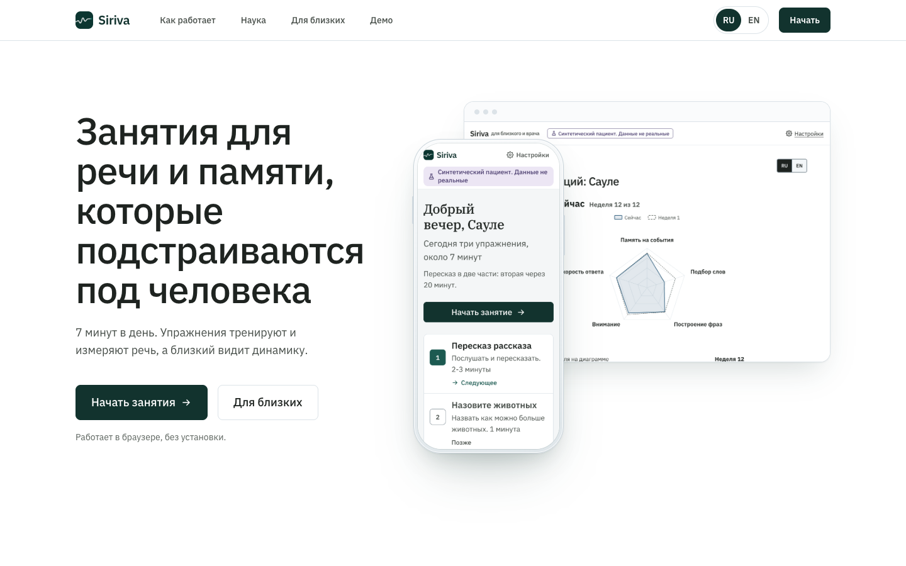
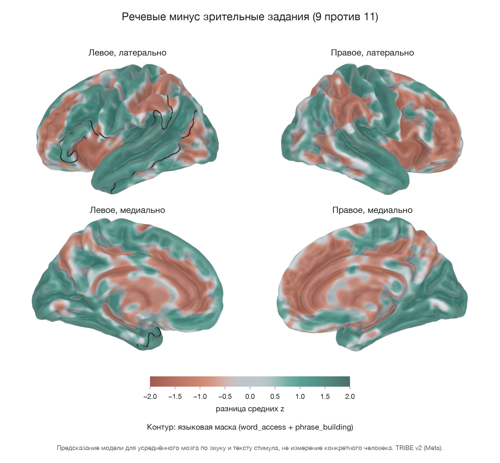
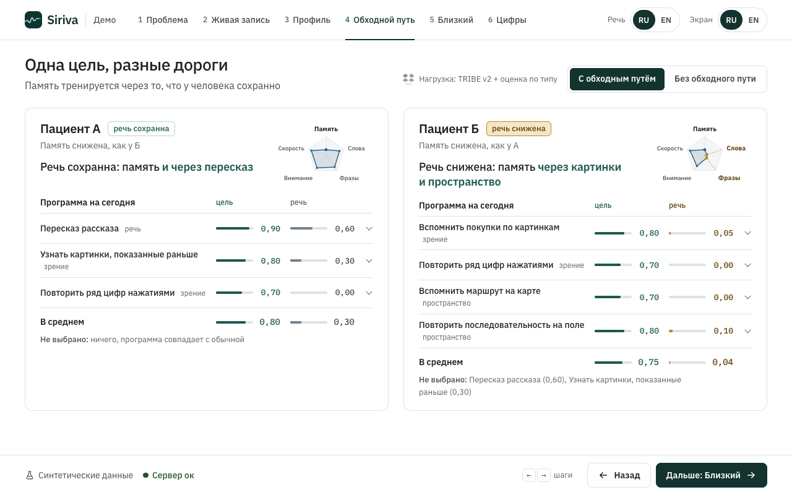

# Siriva

Веб-платформа когнитивной реабилитации для людей с ранними когнитивными нарушениями и их близких. Прототип для хакатона, ноябрь 2026.



Человек каждый день по 5-7 минут описывает картинку, называет животных за минуту и пересказывает короткий рассказ. Пока он говорит, Siriva считает паузы, время до первого слова и сколько деталей он вспомнил. Из этих данных складывается профиль пяти функций: память на события, подбор слов, построение фраз, внимание и скорость ответа. Следующие упражнения подбираются по этому профилю, а близкий видит динамику по неделям.

Если у человека снижена речь, система не даёт ему речевые задания одно за другим. Память тренируется через картинки и пространство. Чтобы понимать, какие функции нагружает каждое упражнение, мы прогнали библиотеку упражнений через модель мозга TRIBE v2 от Meta.

Siriva не ставит диагноз и не лечит. Это инструмент занятий и наблюдения за динамикой.

## Что посмотреть за 5 минут

Если запускать ничего не хочется, вот порядок файлов:

1. [`pitch/Siriva-pitch.pdf`](pitch/Siriva-pitch.pdf): презентация.
2. [`tribe/viz/diff_speech_minus_visual_ru.png`](tribe/viz/diff_speech_minus_visual_ru.png): что TRIBE v2 предсказал для наших упражнений (подробнее ниже).
3. [`web/docs/screens/`](web/docs/screens/): все экраны продукта.
4. [`tribe/REPORT-v2.md`](tribe/REPORT-v2.md): как мы считали нагрузку и как её проверяли.

## Как запустить у себя

Нужны macOS или Linux, Python 3.10+ и Node.js 20+. Интернет нужен только при первом запуске: скачиваются зависимости, модель распознавания речи Whisper small (около 470 МБ) и исследовательский классификатор (около 1 ГБ). Дальше всё работает без сети, голос никуда не отправляется.

```bash
git clone https://github.com/shadix23/siriva && cd siriva
cd backend && python3 -m venv .venv && .venv/bin/pip install -r requirements.txt && cd ..
cd web && npm install && cd ..
./start-demo.sh
```

Скрипт поднимает сервер на `:8000` и сайт на `:3000`, ждёт, пока прогреется модель речи, и сбрасывает демо-данные. Остановка: Ctrl+C.

| Адрес | Что там |
|---|---|
| http://127.0.0.1:3000 | Сайт Siriva (RU/EN) |
| http://127.0.0.1:3000/demo | Демо для жюри, 6 шагов, переключение стрелками |
| http://127.0.0.1:3000/app | Приложение пациента: согласие, программа на сегодня, упражнения |
| http://127.0.0.1:3000/family | Экран близкого |
| http://127.0.0.1:8000/docs | API (Swagger) |

На шаге 2 демо можно говорить в микрофон по-русски или по-английски. Если микрофона нет, клавиша B включает заранее записанный пример. Все пациенты в демо синтетические.

Тесты сервера: `cd backend && .venv/bin/python -m pytest`.

## Как мы использовали TRIBE v2

TRIBE v2 (Meta FAIR, 2026) предсказывает, как кора мозга откликается на видео, звук и текст. Мы применяли её один раз, заранее, к самим упражнениям, а не к людям. Во время работы сайта модель не запускается: сервер читает готовую таблицу «упражнение × функция».

Как это было:

1. Для каждого из 25 упражнений мы собрали стимул на английском (язык обучения модели): звук инструкции и материала, для речевых заданий ещё и текст с таймингами слов.
2. TRIBE v2 выдала предсказание отклика по 20 484 точкам коры, по секунде. Эти выходы лежат в [`tribe/features-v2/`](tribe/features-v2/) (массивы `время × 20484`).
3. Мы усреднили отклик по зонам, которые отвечают за каждую функцию (атласы Schaefer-400 и Destrieux), и получили матрицу нагрузки: [`tribe/out/load_matrix.tribe_v2.en.audio-text.json`](tribe/out/load_matrix.tribe_v2.en.audio-text.json).



На карте разница предсказанного отклика между речевыми (9) и зрительными (11) упражнениями. Зелёное выше у речевых, чёрный контур обводит языковую сеть. У речевых заданий модель сильнее нагружает верхнюю височную и слуховую кору. Внутри языковой сети средняя разница +1,0 стандартного отклонения против +0,1 вне её.

Проверку мы провели двумя способами. Подробности в [`tribe/REPORT-v2.md`](tribe/REPORT-v2.md).

| Функция | Совпадение с оценкой по типу задания (Спирмен, 25 упражнений) | Речевые против зрительных (Манн-Уитни) |
|---|---|---|
| Подбор слов | 0,88 (p<0,001) | речевые выше, p<0,001 |
| Построение фраз | 0,68 (p<0,001) | речевые выше, p<0,001 |
| Внимание | 0,03 | зрительные выше, p=0,002 |
| Память на события | 0,10 | не используем |

Для памяти модель не годится: в публичной версии нет гиппокампа. Поэтому в продукте стоит гибрид [`tribe/out/load_matrix.hybrid.json`](tribe/out/load_matrix.hybrid.json): нагрузку на речь и внимание даёт TRIBE v2, на память и скорость даёт оценка по типу задания. Именно по гибриду работает обходной путь на шаге 4 демо.



Пересчитать всё самим можно скриптами из [`tribe/mac/v2/`](tribe/mac/v2/). Понадобится около 12 ГБ моделей (TRIBE v2, Wav2Vec-BERT, Llama-3.2-3B) и примерно час на Mac M-серии или 20-40 минут на видеокарте. Команды есть в конце `REPORT-v2.md`.

## Что работает и что пока нет

Работает:
- три речевых упражнения (описание картинки, животные за минуту, пересказ сразу и через 20 минут) и два упражнения без речи;
- распознавание речи на ноутбуке (faster-whisper) на русском и английском, около 10 секунд на минуту речи;
- профиль пяти функций, подбор программы по матрице нагрузки, сложность по модели IRT, повторы по модели забывания;
- экран близкого с траекторией по неделям и спокойным флагом, если функция падает быстрее обычного;
- согласие на запись голоса, отдельное разрешение показывать динамику близкому, удаление всех данных. Голос удаляется сразу после распознавания.

Пока нет:
- Классификатор на данных ADReSS. Доступ к DementiaBank выдаётся только по заявке от сотрудника вуза или клиники, мы его ещё не получили. В демо вместо него подключена готовая модель xlm-roberta (vjsyong, MIT) для английской речи. Её точность не подтверждена, и мы показываем её только как работающий конвейер.
- Проверка на реальных людях. Все истории в демо синтетические, веса профиля откалиброваны на синтетике.
- Видеочасть TRIBE v2. Мы считали звук и текст, видео на 16 ГБ памяти не поместилось.
- Казахский язык. Открытых наборов речи людей с когнитивными нарушениями на казахском и русском мы не нашли. Это следующий шаг.

## Структура

```
backend/   сервер: FastAPI, распознавание речи, признаки, профиль, подбор, IRT, тесты
web/       сайт и приложение: Next.js, TypeScript
tribe/     прогон TRIBE v2: стимулы, выходы модели, матрицы, карты мозга, отчёты
docs/      контракт API, UX-спецификация, исследования и источники, отчёты проверок
pitch/     презентация (PPTX, PDF), речь, ответы на вопросы
design/    логотип и графика
```

## Источники и лицензии

- TRIBE v2: d'Ascoli et al., 2026, arXiv 2605.04326, лицензия CC BY-NC 4.0. Матрицы и карты из `tribe/` можно использовать только некоммерчески.
- Llama 3.2 (текстовые признаки для TRIBE): Llama 3.2 Community License. Built with Llama.
- Цифры о речи и реабилитации: Eyigoz et al., EClinicalMedicine 2020 (DOI 10.1016/j.eclinm.2020.100583); Clare et al., GREAT trial, 2019 (DOI 10.1002/gps.5076). Остальные источники в [`docs/RESEARCH-ACCESS-TRIBE.md`](docs/RESEARCH-ACCESS-TRIBE.md).
- Шрифты IBM Plex, лицензия OFL.

## Команда

Shadil Nurmukhammed, founder. Amangeldiev Kaisar, co-founder.
