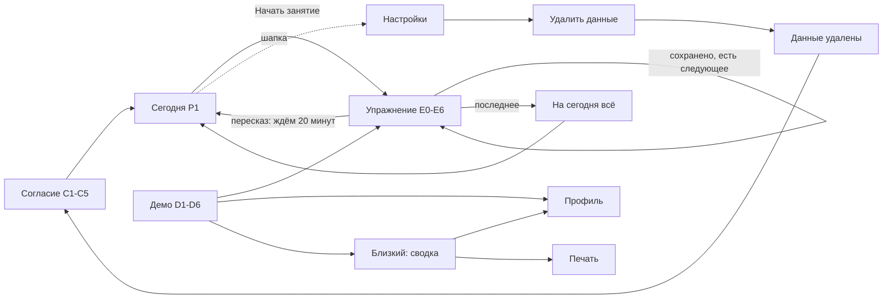

# Es: архитектура интерфейса MVP

Проект: [[map/Es]], карточка: [[es/Карточка Es MVP]], план: [[es-mvp-plan]], опыт JAZ: [[es/docs/FROM-JAZ]].
Прототип: `es/docs/prototype/index.html` (один файл, без сети; экран «Сегодня» и упражнение «Описание картинки» со всеми состояниями записи и панелью жюри).

Кто читает: frontend (экраны, компоненты, токены), backend (разделы 11 и 15: что интерфейс берёт из контракта API v0.1 и чего в нём не хватает), verifier и user-tester (критерии в разделах 6 и 8), pitch-deck (раздел 6 совпадает со сценарием демо).

---

## 1. Аудитория и место использования

| Кто | Что ему нужно | Где и как | Что из этого следует |
|---|---|---|---|
| Человек с ранними когнитивными нарушениями, 60-85 лет | понять, что делать сегодня, спокойно пройти 2-3 упражнения голосом, не почувствовать проверки | дома, ноутбук или планшет, иногда телефон; хуже зрение и слух, тремор, мало опыта с браузером | один главный шаг на экране, крупный текст и кнопки, никаких баллов и таймеров «с нажимом», восстановление после любой ошибки без потери записи |
| Близкий (взрослый ребёнок, супруг) | увидеть, как меняются функции по неделям, и вовремя понять, что пора к специалисту | телефон или ноутбук, урывками | экран-сводка из трёх карточек, тренд вместо вывода, понятный текст флага |
| Врач (второй зритель экрана близкого) | траектория по доменам и микрометрики, без маркетинга | ноутбук, приём 10 минут | таблица значений рядом с графиком, пометка «предварительно, без валидации на пациентах» |
| Жюри | за 4 минуты увидеть новизну: речь как измерение, профиль, обходной путь, честные цифры | проектор 1280-1920 px, с 5-10 метров | демо-режим с крупной типографикой, живыми метриками и явными метками синтетики и заглушек |
| Ведущий демо (член команды) | провести сценарий без сбоев и без сети | ноутбук, кликер или клавиатура | клавиши шагов, резервная запись, индикатор локального сервера |

Принятые решения пользователя: интерфейс на русском; речь в упражнении на русском или английском (выбор перед упражнением); демо работает без сети; синтетический пациент помечен на каждом экране.

---

## 2. Референсы и что берём

Веб был доступен, ссылки проверены поиском 14.11.2026.

| Референс | Что подходит нашему сценарию | Почему |
|---|---|---|
| [Constant Therapy](https://constanttherapy.com), [материал для близких](https://constanttherapyhealth.com/brainwire/caregivers-play-active-roles-in-the-constant-therapy-journey/) | ежедневная программа, которая подстраивается под человека; отчёт для близкого и специалиста открывается в браузере отдельно от экрана упражнений | у нас та же связка «пациент делает, близкий смотрит», но Es адаптирует по микрометрикам, а не по проценту правильных |
| [Winterlight Labs, исследование описания картинки](https://www.frontiersin.org/journals/digital-health/articles/10.3389/fdgth.2021.749758/full) | описание картинки как основной речевой тест; собственные картинки, сопоставимые по числу смысловых единиц с «Cookie Theft»; надёжность при повторе с разными картинками | подтверждает выбор упражнения и то, что картинки можно чередовать. Саму «Cookie Theft» не используем: она из закрытого теста, рисуем свою |
| [GOV.UK: одна задача на странице](https://designnotes.blog.gov.uk/2015/07/03/one-thing-per-page/), [паттерн question pages](https://design-system.service.gov.uk/patterns/question-pages) | один вопрос или одно действие на экран; согласие по шагам | проверено на неуверенных пользователях; снижает когнитивную нагрузку, что важнее всего для нашей аудитории |
| [DWP Accessibility Manual](https://accessibility-manual.dwp.gov.uk/guidance-for-your-job-role/interaction-designer) | начинать с «одного на странице» вместо условных раскрытий | прямое обоснование против аккордеонов и модалок в пути пациента |
| [NHS Service Manual: доступность](https://service-manual.nhs.uk/accessibility/design), [стандарт 5](https://service-manual.nhs.uk/service-standard/5-make-sure-everyone-can-use-the-service) | контраст AA как минимум и AAA где возможно; писать для низкой цифровой и медицинской грамотности | медицинский контекст и пожилая аудитория, наш тон и порог контраста |
| [W3C WAI: пожилые пользователи](https://www.w3.org/WAI/older-users/) | потребности пожилых покрываются WCAG; важны масштаб браузера и сниженная контрастная чувствительность | основание брать WCAG 2.2 AA за пол и AAA для текста |
| [Apple Health: обмен данными с близким](https://www.apple.com/newsroom/2021/06/apple-advances-personal-health-by-introducing-secure-sharing-and-new-insights/), [CareKit UX](https://developer-rno.apple.com/design/human-interface-guidelines/technologies/carekit/user-experience) | близкий видит сводку и тренды, а не сырые записи; человек сам решает, чем делиться; уведомления сводные | модель экрана близкого и раздельное согласие «показывать динамику близкому» |
| [Критика Lumosity (Alzforum, FTC)](https://alzforum.org/node/560326) | антиреференс: очки, уровни, обещания «улучшить мозг», игра на тревоге пожилых | поэтому у нас нет геймификации, баллов и обещаний лечения |

---

## 3. Принципы интерфейса

1. **Одно главное действие на экране.** Оно крупное, тёмно-зелёное и всегда в одном месте. Всё остальное вторично и визуально тише.
2. **Измерение не видно пациенту.** Пациент видит «сделано» и «сохранено», никогда «правильно», «баллы», «результат». Метрики видят близкий, врач и жюри.
3. **Время без давления.** Вместо обратного отсчёта по секундам: спокойная полоса и фраза «можно говорить ещё немного». Точные секунды только в демо-режиме.
4. **Запись не теряется.** Любой сбой отправки оставляет запись на устройстве и предлагает отправить ещё раз.
5. **Честность на каждом экране.** Метка синтетики, метка заглушки матрицы, пометка «предварительно» у профиля, «ждёт данных» вместо выдуманных чисел.
6. **Тренд, а не вывод.** Флаг для близкого говорит, что меняется и с какой скоростью, и предлагает обсудить со специалистом. Никаких названий болезней.
7. **Тихо.** Нет анимаций появления, конфетти, звуков успеха. Движение только там, где оно сообщает состояние (уровень микрофона, рост шкалы записи).

---

## 4. Карта экранов

Маршруты Next.js. Аккаунтов и ролей нет (граница MVP): экраны открываются по ссылке, в демо пациент выбирается в шапке демо-режима.

| Код | Маршрут | Экран | Кто видит | Главное действие |
|---|---|---|---|---|
| C1-C5 | `/consent?step=1..5` | Согласие по шагам | пациент (и близкий рядом) | «Дальше», на последнем шаге «Даю согласие и начинаю» |
| P1 | `/` | Сегодня (программа на день) | пациент | «Начать занятие» |
| E0-E6 | `/exercise/[itemId]` | Упражнение (этапы внутри одного маршрута) | пациент | зависит от этапа, всегда одна кнопка |
| P2 | `/done` | На сегодня всё | пациент | «Вернуться на главную» |
| F1 | `/family` | Близкий и врач: сводка | близкий, врач | «Открыть траекторию» |
| F2 | `/family/profile` | Профиль функций (лепестковая диаграмма и динамика) | близкий, врач, жюри | переключатель недели |
| F3 | `/family/print` | Сводка для специалиста (печать) | близкий | «Распечатать» (желательно, не обязательно для MVP) |
| S1 | `/settings` | Настройки: размер текста, язык речи, данные | пациент, близкий | «Сохранить» |
| S2 | `/settings/delete` | Удалить все мои данные | пациент, близкий | «Удалить все данные» |
| S3 | `/deleted` | Данные удалены | пациент | «Пройти согласие заново» |
| D1-D6 | `/demo?step=1..6` | Демо для жюри | ведущий, жюри | следующий шаг (клавиша или кнопка) |
| X1 | любой | Нет связи с локальным сервером (баннер или экран) | все | «Проверить ещё раз» |
| X2 | `404` | Страница не найдена | все | «На главную» |



Навигация пациента: шапка с логотипом Es (ссылка на «Сегодня»), переключатель размера текста A / A+ / A++, ссылка «Настройки». Нижнего меню и вкладок нет. Профиль с пациентского экрана не открывается: на нём есть числа и сравнение, это экран для близкого и врача (решение D3).

---

## 5. Экраны подробно

Для каждого экрана: цель, содержание сверху вниз, действия, данные, состояния. Тексты даны как финальные формулировки (словарь в разделе 12).

### 5.1 Согласие (C1-C5)

Цель: человек понимает, что делает Es, чего не делает, что записывается и как всё удалить. По одному смысловому блоку на экран (GOV.UK). Внизу каждого шага: «Дальше» (главная), «Назад» (вторичная), индикатор «Шаг 2 из 5» текстом.

| Шаг | Заголовок | Содержание |
|---|---|---|
| C1 | Что такое Es | Короткие ежедневные упражнения на речь и память, 10-15 минут. По голосу во время упражнений Es замечает, какие функции меняются, и подбирает следующие упражнения. Es не ставит диагноз и не заменяет врача. |
| C2 | Кому подходит и когда нужен врач | Подходит тем, кто замечает небольшие трудности с памятью или подбором слов, и их близким. Обратитесь к врачу, если трудности заметно выросли за последние недели. Блок «Сразу вызовите скорую: 103 или 112» (рамка, не красная заливка): внезапная слабость или онемение одной стороны тела, внезапные трудности с речью, резкая спутанность. |
| C3 | Запись голоса | Микрофон включается только во время упражнения, это видно по метке «Идёт запись». Запись обрабатывается на этом компьютере. Сразу после распознавания звук удаляется, хранятся только показатели речи (паузы, темп, слова). Текст расшифровки тоже не хранится (так в контракте API v0.1). |
| C4 | Ваши данные | Удалить всё можно в любой момент: «Настройки», затем «Удалить все мои данные». Согласие можно отозвать там же. В этой версии экран для близкого открывается по ссылке на этом устройстве, отдельных аккаунтов нет. |
| C5 | Согласие | Два отдельных флажка: «Даю согласие на запись голоса во время упражнений» (обязательный), «Разрешаю показывать мою динамику близкому» (по желанию). Кнопка «Даю согласие и начинаю» активна только с первым флажком; при попытке нажать без него текст ошибки над флажком: «Чтобы начать, отметьте согласие на запись голоса». Вторичная ссылка «Не сейчас». |

- «Не сейчас» ведёт на экран: «Без согласия упражнения с записью голоса недоступны. Вернуться можно в любой момент.» и кнопка «Вернуться к согласию».
- Данные: `POST /patients` с `consent_voice: true` (новый пациент) или `PATCH /patients/{id}` (изменение согласия). Флажок «показывать близкому» и версия текста согласия в контракте пока не хранятся (раздел 15, Р7). Если согласие уже есть, `/consent` не показывается, `/` открывается сразу.
- Состояния: ошибка сохранения («Не получилось сохранить согласие. Проверьте, что программа Es запущена, и нажмите ещё раз»), загрузка (кнопка показывает «Сохраняем…» и неактивна).
- В демо-режиме согласие можно показать одним кадром (C1) и пропустить.

### 5.2 Сегодня (P1), экран пациента

Цель: за 3 секунды понять, что делать, и начать. Без баллов, оценок и рейтингов. Прогресс = регулярность и «сделано», а не качество.

Сверху вниз:
1. Шапка: Es, метка «Синтетический пациент. Данные не реальные» (в демо-сборке), A / A+ / A++, «Настройки».
2. Приветствие по времени суток: «Добрый день, Анна Петровна». Под ним одна строка: «Сегодня три упражнения, около 12 минут».
3. Главная кнопка: «Начать занятие» (открывает первый несделанный пункт). Если что-то уже сделано: «Продолжить занятие».
4. Список программы (не карточки-плитки, а нумерованный список строк, каждая строка целиком нажимается):
   - номер, название упражнения, одна строка «что делать» («Расскажите, что видите на картинке»), длительность «1-1,5 минуты»;
   - статус текстом и значком: «Сделано» (галочка), «Следующее», «Позже», «Вторая часть в 14:35» (часы), «Ждёт отправки» (облако со стрелкой).
5. Блок «На этой неделе»: «Вы занимались 4 дня из 7». Без серий, без «не прерывайте серию», без медалей.
6. Тихая ссылка внизу: «Почему такие упражнения?» Раскрывает 2 предложения: «Упражнения подобраны под вас: они тренируют память через то, что у вас получается легко. Подбор меняется каждый день.» Без доменов и чисел.

Действия: «Начать занятие»; нажатие на строку открывает этот пункт (кроме «Вторая часть в 14:35», который до времени неактивен и объясняет: «Вторая часть пересказа откроется в 14:35. Пока можно сделать другие упражнения»).

Данные: `GET /patients/{id}/program/today` плюс состояние сегодняшней сессии, которое клиент хранит сам (раздел 11.4).

Неречевые задания. Подбор по контракту выбирает из 25 упражнений, среди них неречевые (`speech_output: false`, например «Повторить последовательность на поле»). В пути пациента показываются только те задания, у которых есть экран во frontend. Для MVP достаточно трёх речевых и двух неречевых, нужных пациенту Б в демо обходного пути: у неречевых тот же каркас E0, E3, E6 без записи голоса, с кнопкой «Готово» и отправкой `/result` и `/telemetry`. Какие именно неречевые делать, решает главная сессия (вопрос Q9).

Состояния:
- Загрузка: статичный каркас списка (серые строки без мерцания) и текст «Готовим программу на сегодня». Не спиннер.
- Ошибка: «Не получилось загрузить программу. Проверьте, что программа Es запущена на этом компьютере.» Кнопка «Попробовать ещё раз».
- Пусто, всё сделано: «На сегодня всё. Спасибо! Следующие упражнения завтра.» Главная кнопка исчезает, остаётся спокойный текст.
- Пусто, программы нет (первый запуск до подбора): «Подбираем первые упражнения. Это займёт несколько секунд.» и автоповтор раз в 5 секунд.
- Есть записи, ждущие отправки: баннер над списком «Одна запись ещё не отправлена. Она сохранена на этом устройстве.» Кнопка «Отправить сейчас».
- Вторая часть пересказа готова: строка переходит в статус «Можно сейчас», а над главной кнопкой появляется тихий баннер «Можно рассказать историю ещё раз». Без всплывающих окон и звуков.

### 5.3 Упражнение: общий каркас (E0-E6)

Один маршрут, этапы сменяют друг друга на месте, фокус переносится на заголовок нового этапа. Шапка упражнения: «К программе» (слева), «Упражнение 1 из 3», метка синтетики.

| Этап | Экран | Главное действие | Переход |
|---|---|---|---|
| E0 | Что будем делать: название, 1-2 предложения инструкции, длительность | «Понятно, дальше» | E1 |
| E1 | На каком языке будете говорить? Две крупные кнопки «Русский», «English»; выбранный в прошлый раз язык уже отмечен | «Дальше» | E2 или E3 |
| E2 | Проверка микрофона (первое упражнение за день или после ошибки микрофона). Сначала объяснение: «Сейчас браузер спросит разрешение на микрофон. Нажмите «Разрешить».» Затем: «Скажите вслух: «Сегодня хороший день»». Полоса уровня и текст «Слышно хорошо» или «Пока не слышно» | «Микрофон работает, начать» | E3 |
| E3 | Готовность: стимул на экране (картинка, или кнопка «Послушать рассказ», или категория), инструкция | «Начать запись» | E4 |
| E4 | Идёт запись: метка «Идёт запись» (ржавый цвет, значок и текст), спокойная шкала времени, уровень микрофона, «Подсказка» | «Закончить запись» | E5 |
| E5 | Сохраняем: «Сохраняем запись» (меньше секунды: запись кладётся в IndexedDB и ставится в очередь отправки) | нет (автоматически) | E6 |
| E6 | Спасибо: «Спасибо. Упражнение сохранено.» и что дальше | «Следующее упражнение: Назовите животных» или «Вернуться к программе» | E0 следующего или P2 |

Правила для всех упражнений:
- Время: шкала заполняется слева направо; под ней фраза, меняющаяся раз в 15 секунд: «Говорите как обычно», «Можно говорить ещё немного», «Осталось совсем немного». Цифры секунд пациенту не показываем (решение D4). Для экранного диктора объявления только на 30 и 10 секундах до конца (`aria-live="polite"`).
- Подсказка: кнопка «Подсказка» всегда видна во время записи. Показывает одну подсказку за раз, следующая по повторному нажатию. Если человек молчит 7 секунд, кнопка подсказки получает тихую подпись «Можно взять подсказку» (сама подсказка не показывается автоматически, чтобы не искажать измерение; это событие `hint_offered`).
- Окончание по времени: запись останавливается сама, текст «Минута прошла. Спасибо, запись сохранена.» (для называния) или «Спасибо, этого достаточно.» (для описания картинки на 90 секунде).
- Раннее окончание: «Закончить запись» доступна с первой секунды. Если записано меньше 20 секунд речи, на E6 вместо «Спасибо» мягкий выбор: «Запись получилась короткой. Можно оставить так или записать ещё раз.» Кнопки «Оставить так» (главная) и «Записать ещё раз». Оба варианта нормальны.
- Выход во время записи: «К программе» открывает защитный диалог (`<dialog>`, фокус внутри): «Остановить упражнение? Эта запись не сохранится.» Кнопки «Продолжить упражнение» (главная, в фокусе) и «Остановить и выйти». Esc закрывает диалог и продолжает запись. Глобальных горячих клавиш у пациента нет.
- Фокус: после смены этапа фокус на заголовке этапа; после старта записи на «Закончить запись».
- Отправка в фоне (решение D18): в контракте `/audio` синхронный, ответ приходит после распознавания (5-15 секунд). Пациент не ждёт: E6 показывается сразу, как только запись сохранена на устройстве, а запрос идёт в фоне. При 503 или сбое сети клиент сам повторяет один раз через 5 секунд; если снова не вышло, строка в программе получает статус «Ждёт отправки». Запись удаляется с устройства только после ответа 200.

### 5.4 Описание картинки

- E0: «Опишите картинку. Расскажите своими словами всё, что видите: кто там, что происходит. Около полутора минут.»
- E3/E4: картинка крупно (на компьютере слева 60% ширины, на телефоне сверху до 45% высоты экрана, по нажатию открывается на весь экран с кнопкой «Закрыть»). Картинка своя, не «Cookie Theft»: сцена с несколькими действующими лицами и событиями (в прототипе заглушка «двор: бельё, собака с носком, кот, начинается дождь»). У картинки обязательный `alt` для экранного диктора (описание не помогает упражнению, но человек с диктором должен понимать, что на экране; в `alt` даём короткое «Иллюстрация для упражнения: двор у дома»).
- Длительность: от 60 до 90 секунд; автоостановка на 90.
- Подсказки: «Что делают люди на картинке?», «Что происходит слева?», «Что может случиться дальше?».

### 5.5 Беглость называния

- E0: «Назовите как можно больше животных. Любых: домашних, диких, птиц, рыб. У вас одна минута.» Категория может меняться (животные, фрукты, слова на букву), приходит со стимулом.
- E3/E4: крупная надпись категории «Животные» и значок. Шкала ровно 60 секунд, автоостановка.
- Счётчик названных слов пациенту не показываем (решение D5). В демо-режиме счётчик и разбивка по 15 секундам есть на панели жюри.
- Подсказки: «Вспомните домашних животных», «Тех, кто живёт в лесу», «Птиц и рыб».

### 5.6 Пересказ сразу и через 20 минут

Пересказ ставится первым в программе, чтобы ожидание заполнили другие упражнения.

| Часть | Экран | Детали |
|---|---|---|
| Слушать | «Послушайте короткий рассказ. Потом расскажите его своими словами.» Кнопка «Послушать рассказ» (аудио 40-60 с, заранее записано на русском и английском, лежит локально). Во время прослушивания: «Слушаем рассказ», шкала, «Пауза» | Можно прослушать ещё раз один раз («Послушать ещё раз»), событие `story_replayed`. Для тех, кто плохо слышит: ссылка «Показать текст рассказа» (событие `story_text_shown`, это меняет модальность и учитывается при анализе) |
| Пересказ сразу | «Расскажите, что запомнили. Можно своими словами.» Запись до 90 секунд | Подсказка: первые слова рассказа («Рассказ начинался так: «Утром Мария…»») |
| Ожидание | E6 с текстом: «Спасибо. Вторая часть через 20 минут, в 14:35. Пока можно сделать другие упражнения.» Кнопка «Следующее упражнение» | Время абсолютное (14:35), не обратный отсчёт. Время окончания пересказа сразу и `session_id` клиент сохраняет в `localStorage`, чтобы перезагрузка не сбросила ожидание и отложенный пересказ ушёл в ту же сессию (иначе сервер ответит 409 `immediate_missing`). Лучше, если сервер сам вернёт это время (раздел 15, Р4) |
| Пересказ через 20 минут | Строка в программе «Можно сейчас». Экран: «Помните рассказ, который вы слушали? Расскажите его ещё раз, как запомнили.» Без повторного прослушивания | Если прошло больше 60 минут, пересказ всё равно доступен, сервер получает фактическую задержку `delay_minutes`. Если человек закрыл программу на весь день, пересказ переносится на следующее занятие с новым рассказом |
| Демо | В демо-режиме под строкой ожидания кнопка «Демо: пропустить ожидание» с пометкой, что так бывает только в демо | Никогда не показывается вне `/demo` |

### 5.7 Состояния записи (для всех трёх упражнений)

| Состояние | Когда | Что на экране | Действия | Данные и событие |
|---|---|---|---|---|
| Нет разрешения на микрофон | `getUserMedia` вернул `NotAllowedError` | Заголовок «Нужен доступ к микрофону». Текст: «Браузер не разрешил микрофон. Нажмите на значок замка слева от адреса сайта, выберите «Микрофон: разрешить» и нажмите «Попробовать ещё раз».» Рисунок адресной строки с подсвеченным замком (своя иллюстрация, без брендов браузеров) | «Попробовать ещё раз» (главная), «Вернуться к программе». Тихая строка: «Можно попросить близкого помочь с настройкой» | `mic_permission: denied` |
| Нет микрофона | `NotFoundError` или `NotReadableError` | «Микрофон не найден. Проверьте, что микрофон или наушники подключены. Если микрофон занят другой программой (например, видеозвонком), закройте её.» | «Попробовать ещё раз», «Вернуться к программе» | `mic_error: not_found / busy` |
| Тишина в начале | VAD не слышит речи 10 секунд после старта | Над шкалой спокойная плашка (не красная): «Пока вас не слышно. Говорите как обычно, громче не нужно. Если вы говорите, а полоса не двигается, проверьте микрофон.» Запись продолжается | «Подсказка», «Закончить запись» | `silence_warning` |
| Запись без голоса | Остановка, а речи почти нет (меньше 3 секунд голоса) | E6: «Запись получилась без голоса. Возможно, микрофон выключен.» | «Проверить микрофон» (главная, ведёт на E2), «Попробовать ещё раз», «Пропустить на сегодня» | флаг `silent` от клиента и сервера |
| Прерывание | Вкладка скрыта больше 5 секунд, звонок, сон компьютера, перезагрузка страницы, потеря микрофона во время записи | При возврате: «Упражнение прервалось. Ничего страшного, можно начать его заново.» Если записано больше 20 секунд речи, третья кнопка «Сохранить то, что успели» | «Начать заново» (главная), «Сохранить то, что успели», «Вернуться к программе» | `recording_stopped: interrupted`, `visibility_hidden` |
| Сохраняем | после остановки | «Сохраняем запись» и шкала отправки (реальный прогресс загрузки). Кнопок нет | | `upload_started` |
| Ошибка отправки | сеть или сервер не ответили, 5xx (в том числе 503 `transcription_failed`), таймаут 60 с, и автоповтор тоже не прошёл | «Запись сохранена на этом устройстве, но пока не отправилась.» Подпись: «Проверьте, что программа Es запущена. Запись никуда не пропадёт.» | «Отправить ещё раз» (главная), «Отправить позже» (возвращает в программу, строка получает статус «Ждёт отправки») | запись в IndexedDB до подтверждения; `upload_failed` с кодом |
| Запись не принята | 413 `audio_too_large` или 422 `validation_error` | Как ошибка отправки, но текст: «Эту запись не получилось обработать. Попробуйте записать ещё раз.» | «Записать ещё раз» | `upload_failed` с кодом |
| Пустая запись по мнению сервера | 422 `empty_audio` | Как «Запись без голоса» | как там | |
| Нет согласия | 403 `consent_required` (согласие отозвано на другом экране) | «Чтобы записывать голос, нужно согласие. Его можно дать в настройках.» | «Открыть настройки» | |
| Распознавание не удалось в демо | 503 `transcription_failed` во время D2 | Панель жюри: «Распознавание не удалось. Показаны только данные браузера.» и «Повторить» (повторная отправка той же записи). Для пациента это обычная ошибка отправки в фоне | | |

### 5.8 Профиль функций (F2)

Для близкого, врача и жюри. Не для пациента.

1. Шапка: имя, метка синтетики, «Неделя 12 из 12».
2. Лепестковая диаграмма по пяти доменам. Две фигуры: «Сейчас» (сплошная заливка акцентным цветом 20% и контур 2 px) и «Неделя 1» (пунктир, нейтральный цвет). Подписи осей словами, без чисел на осях. Легенда текстом над диаграммой.
3. Переключатель недели (ползунок 1-12 с подписью «Неделя 6») и кнопки «Неделя 1» и «Сейчас». Переход между неделями плавный 200 мс, при `prefers-reduced-motion` мгновенный.
4. Под диаграммой таблица (доступная альтернатива диаграмме и основной вид для врача): домен, что измеряли, было, стало. Пример строки: «Подбор слов | пауза перед существительным | 0,6 с | 0,9 с». Здесь главный тезис плана: не балл, а микрометрики.
5. Пометка внизу: «Профиль предварительный: до калибровки модели он считается по прозрачным правилам из показателей речи. Проверки на реальных пациентах не было.»

Названия доменов в интерфейсе (ключи из контракта API): «Память на события» (`episodic_memory`), «Подбор слов» (`word_access`), «Построение фраз» (`phrase_building`), «Внимание» (`attention`), «Скорость ответа» (`processing_speed`). В таблице для врача и в демо рядом в скобках научный термин из `label_ru` контракта: «Подбор слов (доступ к слову)». Числа 0-100 из `score` на диаграмме не подписываются.

Состояния: загрузка (каркас круга и таблицы), пусто («Профиль появится после трёх занятий. Сейчас сделано: 1.»), ошибка («Не получилось загрузить профиль» и «Попробовать ещё раз»), домен без данных (ось подписана «мало данных», точка не рисуется, в таблице «пока не измерялось»).

### 5.9 Близкий и врач: сводка (F1)

Три блока по порядку важности (меню-задач из JAZ S1, адаптация из FROM-JAZ п.1):
1. **Что обсудить со специалистом.** Если `trend_flag.active`: рамка охристого цвета (не красная), значок, текст флага: «Подбор слов снижается быстрее, чем обычно бывает за такой срок. Стоит обсудить это со специалистом.» Под ним одна строка доказательства из недельных `metrics`: «В упражнении «Назовите животных» за минуту называется меньше слов: 18 в первую неделю, 11 сейчас.» Под ним раскрытие «Что это значит и чего не значит»: «Это изменение в упражнениях за последние 5 недель. Это не диагноз. Причины бывают разными: усталость, сон, лекарства, настроение. Специалист поможет разобраться.» Кнопка «Сводка для специалиста» (F3). Если флага нет: «Сейчас нет изменений, которые стоит обсуждать отдельно.»
2. **Траектория по неделям.** Пять маленьких линейных графиков в столбик (по одному на домен, общая ось недель 1-12, данные `series`), тонкая пунктирная линия «ориентир» от значения первой недели с наклоном `reference_slope_per_week`, флагнутый домен выделен охристой линией и подписью. Ссылка «Подробнее: профиль функций» (F2). Под графиками таблица значений по неделям (кнопка «Показать таблицей»).
3. **Как прошла неделя.** «Занятий: 5 из 7 дней. Все три упражнения: 4 раза. Пропущено: вторник, суббота.» Без оценок.

Плюс в шапке: «Данные показываются, потому что Анна Петровна разрешила это в согласии» (если нет разрешения, экран показывает только этот текст и как его изменить).

Флаг: правило считает backend (`trend_flag`: не меньше 6 недель, наклон и падение относительно ориентира). Текст на экране берётся из словаря frontend по `trend_flag.level` и `trend_flag.domains` (ключ `flag.faster_than_usual`), а не из `trend_flag.message`: в сообщении контракта сокращение «нед.» и подписи доменов строчными внутри кавычек (раздел 15, Р6).

Состояния: пусто («Для траектории нужно хотя бы две недели занятий. Сейчас: 4 дня.»), загрузка, ошибка как в F2.

### 5.10 Настройки и удаление данных (S1-S3)

- S1: размер текста (A / A+ / A++ крупными радиокнопками с образцом текста), язык речи по умолчанию (Русский / English), «Показывать мою динамику близкому» (переключатель, меняет согласие), ссылка «Удалить все мои данные».
- S2: одна задача на экране. «Удалить все данные? Будут удалены все записи, показатели и профиль. Вернуть их будет нельзя.» Чтобы не нажать случайно: флажок «Я понимаю, что данные удалятся навсегда» и кнопка «Удалить все данные» (цвет ошибки, тёмно-красный текст на светлом, не заливка). Вторичная «Отмена».
- S3: «Данные удалены.» Кнопка «Пройти согласие заново».
- Для синтетического пациента в демо удаление сбрасывает его к исходной синтетической истории, текст: «Демо: синтетические данные восстановлены к исходному виду».
- Данные: `DELETE /patients/{id}`; для демо-пациентов затем `POST /demo/reset`.

### 5.11 Демо для жюри (D1-D6)

Отдельный маршрут `/demo`, раскладка под проектор (от 1280 px, базовый текст 24 px). Шапка: «Es. Демо», шаги 1-6 вкладками, индикатор «Локальный сервер: работает» (зелёная точка и текст) или «нет связи» (с кнопкой «Резервный режим»), метка «Синтетические данные», выбор языка речи RU / EN для живой записи.

Управление: стрелка вправо, PageDown и пробел (кликер) = следующий шаг; стрелка влево и PageUp = назад; R = начать или закончить живую запись; B = резервная запись. Горячие клавиши работают только в `/demo` и подсказаны строкой внизу.

| Шаг | Что на экране | Данные |
|---|---|---|
| D1 Проблема | Одна фраза крупно: «Близкие замечают изменения, когда они уже очевидны. А признаки слышны в речи годами раньше.» Без картинок мозга | статично |
| D2 Живая запись | Слева упражнение «Описание картинки» ровно как у пациента (тот же компонент). Справа панель «Что слышит система» (раздел 5.12) | клиентский VAD в реальном времени, затем ответ `POST /sessions/{sid}/exercises/picture_description/audio` |
| D3 Профиль за 12 недель | F2 пациента `demo-trend`; ведущий двигает ползунок недель, фигура смещается; таблица микрометрик | `GET /patients/demo-trend/trajectory` (недели и `metrics`) и `GET /patients/demo-trend/profile` («сейчас», `contributions`, `note`) |
| D4 Обходной путь | Раздел 5.13 | `GET /demo/bypass-scenario` |
| D5 Экран близкого | F1 с флагом по подбору слов | `GET /patients/demo-trend/trajectory` |
| D6 Цифры | Две большие карточки: «Классификатор на ADReSS» (точность на тесте 48 человек и опубликованный бейзлайн 0,75) и «Согласованность разметки» (совпадение нагрузки по матрице с экспертной разметкой). Если числа ещё не посчитаны: «Ждёт данных: доступ к ADReSS запрошен», без выдуманных значений | в контракте нет; пока статичный файл `web/src/demo/numbers.json` со статусом `pending` (раздел 15, Р12) |

### 5.12 Панель жюри «Что слышит система» (D2)

Два уровня, чтобы не обещать того, чего нет в реальном времени (решение D9):

**В реальном времени (считает браузер, обновление 4 раза в секунду):**
- лента речи и пауз: горизонтальная полоса, растущая слева направо; речь блоками акцентного цвета, паузы светлыми промежутками, паузы длиннее 2 секунд подписаны («2,4 с»);
- «Время до первого слова»: 1,4 с;
- «Паузы длиннее 1 с»: 6;
- «Доля пауз»: 31 %;
- «Текущая пауза»: растущее число, пока человек молчит;
- точные секунды записи «0:47 из 1:30».

**После распознавания (ответ `/audio`, Whisper локально, 5-15 секунд после остановки):**
- расшифровка с паузами в тексте («я вижу [1,8 с] женщину, она вешает [2,4 с] бельё»): паузы считаются из промежутков между `transcript.words`, местоимения подчёркнуты пунктиром (список местоимений на клиенте);
- из `features`: «Время до первого слова» (`first_word_latency`), «Доля пауз» (`pause_ratio`), «Пауза перед содержательным словом» (`pause_before_content_mean`), «Слов в минуту» (`speech_rate_wpm`), «Разнообразие слов» (`mattr`), «Доля местоимений» (`pronoun_share`), «Сбои и самоисправления» (`disfluency_per100`, `self_correction_count`);
- «Смысловые единицы картинки: 9 из 14» со списком найденных и ненайденных: в контракте для описания картинки их нет, показываем только если backend добавит (раздел 15, Р9);
- для беглости: `fluency_count`, разбивка по 15 секундам `fluency_segments` (4 столбика), повторы `fluency_repeats`, переключения между группами `fluency_switches`, список `fluency_items`;
- для пересказа: `retell_immediate_frac` сразу, `retell_delayed_frac` через 20 минут, `retell_retention`, число потерянных единиц `retell_units_lost_count`;
- строка языка: «Речь: русский. Классификатор ADReSS работает только для английской речи, для русской показаны показатели речи и профиль» или «Речь: английский. Классификатор: доступен / ждёт данных».

Пока идёт распознавание: «Распознаём речь» и каркас блоков. Ошибка: «Распознавание не удалось. Показаны только данные браузера.» и «Повторить».

Резервная запись (клавиша B или кнопка «Резервная запись»): воспроизводит заранее записанный пример (локальный файл и его слова с таймингами) и проигрывает ленту пауз с теми же таймингами, а метрики получает настоящим запросом `POST /sessions/{sid}/exercises/picture_description/transcript` с сохранёнными словами. Так резерв работает даже без модели распознавания. Над панелью всё время видна метка «Заранее записанный пример».

### 5.13 Обходной путь (D4), главный кадр

Цель: за 60 секунд показать, что два человека с одинаковым дефицитом памяти получают разные программы и почему.

Раскладка: два столбца «Пациент А» и «Пациент Б» (оба с меткой «синтетический»), у каждого:
1. Маленькая лепестковая диаграмма. Общая для обоих просадка «Память на события» выделена одинаковой подписью «одинаково снижена». Различие подписано: у А «Построение фраз: сохранно», у Б «Построение фраз: снижено».
2. «Программа на сегодня» (`program.items`): 3-4 строки. В каждой: название (`title`), канал словом («речь», «зрение», «пространство» из `channel`), пять тонких горизонтальных полосок `predicted_load` (целевой домен акцентный, домены из `avoid_domains` охристые, остальные серые), числа рядом с десятичной запятой (0,80).
3. «Почему так»: одно предложение простыми словами. Общий текст из `explanation` сценария, для столбца Б короткая версия из словаря: «Память тренируется через зрительные и пространственные задания, потому что речевые функции сейчас снижены.»
4. «Не выбрано»: 1-2 строки, это `naive_item_ids`, которых нет в программе. Причину frontend собирает из `predicted_load` задания (данные `GET /exercises`) и `avoid_domains`: «Пересказ рассказа: большая нагрузка на «Построение фраз» (0,6), а у этого человека построение фраз снижено.»

Над столбцами переключатель «С обходным путём / Без обходного пути». Без обходного пути у обоих показывается программа из `naive_item_ids` (одинаковая или почти одинаковая), у Б подсвечиваются задания с высокой нагрузкой на домены из `avoid_domains`. Это и есть визуальный довод. Флаги `same_memory_score` и `programs_differ` из ответа используются как проверка перед показом: если какой-то `false`, ведущий видит предупреждение в шапке демо.

Внизу всегда видна честная строка, пока `load_source` содержит `placeholder`: «Нагрузка упражнений предварительная: оценена по типу задания, не TRIBE v2. Структура подбора настоящая.» После прогона: «Нагрузка упражнений: предсказания TRIBE v2 (Meta, CC BY-NC 4.0), только некоммерческое использование.» Слова «нейронная разметка» и «показания мозга» не используем (договорённость контракта).

---

## 6. Главный сценарий демо по шагам

Совпадает с разделом «Сценарий демо» плана и со слайдом пути (FROM-JAZ п.2). Перед выступлением: запущены backend и frontend локально, Wi-Fi можно выключить, открыт `/demo?step=1`, индикатор сервера зелёный, микрофон проверен на E2.

| Время | Шаг | Что на экране | Действие ведущего | Переход | Страховка |
|---|---|---|---|---|---|
| 0:00-0:15 | D1 Проблема | одна фраза о близких и речи, метка синтетики в шапке | говорит фразу | → | слайд дублирует |
| 0:15-1:15 | D2 Живая запись | слева картинка и «Начать запись», справа пустая панель с подписями метрик | R: запись пошла. Говорит 45-60 секунд, специально делает паузы. Лента речи растёт, «Время до первого слова» и «Паузы длиннее 1 с» обновляются. R: стоп. Через 5-15 секунд появляется расшифровка с паузами в тексте и смысловые единицы | → | B: резервная запись с меткой «Заранее записанный пример»; если сервер упал, только браузерные метрики |
| 1:15-2:00 | D3 Профиль | лепестковая диаграмма синтетического пациента, неделя 1, таблица микрометрик | двигает ползунок с недели 1 на 12, фигура сжимается по «Подбору слов»; показывает строку таблицы «пауза перед существительным 0,6 → 0,9 с» | → | данные локальные, сбоя сети быть не может |
| 2:00-3:00 | D4 Обходной путь | два столбца, режим «Без обходного пути»: программы одинаковые, у Б подсвечены тяжёлые для него упражнения | переключает на «С обходным путём»: программа Б меняется, появляются «Почему так» и «Не выбрано» | → | статичная раскладка, без запросов во время показа (данные загружены на D1) |
| 3:00-3:30 | D5 Близкий | F1: флаг «Подбор слов снижается быстрее, чем обычно… Стоит обсудить со специалистом» и строка про беглость (18 слов в первую неделю, 11 сейчас), графики по неделям | читает флаг, раскрывает «Что это значит и чего не значит» | → | |
| 3:30-4:00 | D6 Цифры | две карточки: ADReSS и согласованность разметки, или «Ждёт данных» | называет числа или честно говорит о статусе | конец | слайд с цифрами |

Все данные для D3-D6 загружаются один раз при открытии `/demo` (предзагрузка), чтобы переходы шли без ожидания.

---

## 7. Макеты главного сценария

Рабочий прототип: `es/docs/prototype/index.html` (экран «Сегодня», упражнение «Описание картинки», переключатель состояний записи, панель жюри, A / A+ / A++). Схемы ниже фиксируют раскладку для frontend.

### 7.1 Сегодня, телефон 375 px
```
┌───────────────────────────────┐
│ Es                 Aa  Настр. │
│ [Синтетический пациент...]    │
│                               │
│ Добрый день,                  │
│ Анна Петровна                 │
│ Сегодня три упражнения,       │
│ около 12 минут                │
│                               │
│ ┌───────────────────────────┐ │
│ │      Начать занятие       │ │  56+ px, на всю ширину
│ └───────────────────────────┘ │
│                               │
│ 1  Пересказ рассказа        ✓ │
│    Сделано                    │
│ ───────────────────────────── │
│ 2  Описание картинки        → │
│    Следующее, 1-1,5 минуты    │
│ ───────────────────────────── │
│ 3  Пересказ, вторая часть   ◷ │
│    В 14:35                    │
│                               │
│ На этой неделе: 4 дня из 7    │
│ Почему такие упражнения?      │
└───────────────────────────────┘
```

### 7.2 Сегодня, компьютер 1280 px
Одна колонка шириной до 720 px по центру (длинные строки трудно читать), те же блоки. Справа ничего нет: пустое поле лучше второй колонки с отвлекающими данными.

### 7.3 Упражнение, телефон 375 px
```
┌───────────────────────────────┐
│ ← К программе    1 из 3       │
│ [Синтетический пациент...]    │
│ ┌───────────────────────────┐ │
│ │                           │ │
│ │        картинка           │ │  до 45% высоты
│ │                     [⤢]   │ │
│ └───────────────────────────┘ │
│ ● Идёт запись                 │
│ Говорите как обычно           │
│ ▓▓▓▓▓▓▓▓░░░░░░░░░░░░░░░░░░░░  │  шкала времени
│ Микрофон: ▮▮▮▯▯ слышно        │
│                               │
│ [ Подсказка ]                 │
├───────────────────────────────┤
│ ┌───────────────────────────┐ │  нижняя панель
│ │     Закончить запись      │ │  закреплена
│ └───────────────────────────┘ │
└───────────────────────────────┘
```

### 7.4 Упражнение, компьютер 1280 px
```
┌──────────────────────────────────────────────────────────────┐
│ ← К программе      Упражнение 1 из 3      [Синтетический...] │
├────────────────────────────────────┬─────────────────────────┤
│                                    │ Опишите картинку        │
│                                    │ Расскажите всё, что     │
│            картинка                │ видите.                 │
│            (60%)                   │                         │
│                                    │ ● Идёт запись           │
│                                    │ ▓▓▓▓▓▓░░░░░░░░░░        │
│                                    │ Говорите как обычно     │
│                                    │ Микрофон ▮▮▮▯▯          │
│                                    │                         │
│                                    │ [ Закончить запись ]    │
│                                    │ [ Подсказка ]           │
└────────────────────────────────────┴─────────────────────────┘
```
В демо-режиме справа добавляется третья колонка, панель жюри (5.12), а упражнение занимает левые две трети.

---

## 8. Доступность для пожилых

Пол: WCAG 2.2 AA. Для текста цель AAA (7:1). Каждое требование проверяемо.

| # | Требование | Как проверить |
|---|---|---|
| A1 | Размер текста по умолчанию A+ = 20 px, A = 18 px, A++ = 24 px. Ничего мельче 16 px при A. Переключатель в шапке, выбор запоминается | при A++ и масштабе браузера 200% нет обрезки и горизонтальной прокрутки на 375 и 1280 px |
| A2 | Все размеры в rem, переключатель меняет `font-size` у `html` | смена A / A+ / A++ меняет и отступы, и кнопки |
| A3 | Цели нажатия: главная кнопка от 56 px высотой и на всю ширину на телефоне; любые другие от 48x48 px; расстояние между целями от 12 px | замер в DevTools |
| A4 | Контраст: основной текст 14:1, вторичный от 7:1, акцентные кнопки 8:1, границы полей и значки от 3:1 (значения в разделе 9) | проверка контраста по токенам |
| A5 | Один главный шаг на экране: одна кнопка в стиле «главная» на экран | ревью каждого экрана |
| A6 | Состояние не только цветом: «Идёт запись» = значок + текст + цвет; статус в программе = текст + значок | экран в оттенках серого остаётся понятным |
| A7 | Минимум движения: нет анимаций появления, параллакса, автокарусели, мигания. Разрешено: уровень микрофона, рост шкалы, смена недели в профиле (200 мс). При `prefers-reduced-motion: reduce` уровень микрофона заменяется текстом «слышно / не слышно», переходы мгновенные | эмуляция reduced motion |
| A8 | Клавиатура: весь путь пациента проходится Tab, Enter и пробелом; порядок фокуса совпадает с визуальным; фокус виден всегда (рамка 3 px цвета текста и жёлтое поле вокруг) | пройти согласие, программу и упражнение без мыши |
| A9 | Фокус при смене этапа переносится на заголовок нового этапа (`tabindex="-1"`), диалог «Остановить упражнение?» держит фокус и закрывается Esc | экранный диктор VoiceOver читает новый заголовок |
| A10 | Объявления для диктора: смена этапа, «Идёт запись», «Запись сохранена», ошибки (`role="status"` или `aria-live="polite"`; ошибки отправки `role="alert"`). Время: только на 30 и 10 секундах | VoiceOver на macOS |
| A11 | Ошибки называют проблему и следующий шаг, рядом с местом ошибки, с кнопкой восстановления. Нигде нет тупика без кнопки | пройти все строки таблицы 5.7 |
| A12 | Нет ограничений по времени вне самих упражнений: сессия не истекает, страницы не уходят сами | оставить экран на 30 минут |
| A13 | Тексты: короткие предложения, обычные слова, без терминов у пациента; уровень чтения около 6-8 класса | словарь раздела 12 |
| A14 | Язык страницы `lang="ru"`; английские куски (кнопка «English», расшифровка английской речи) с `lang="en"` | валидатор |
| A15 | Картинки упражнений с `alt`; графики профиля и траектории с таблицей-альтернативой | диктор читает таблицу |
| A16 | Ширина строки текста 60-70 знаков, межстрочный интервал 1,55 | замер |
| A17 | Звуки: никаких звуков успеха и ошибок; единственный звук в продукте - рассказ в упражнении пересказа, с видимыми кнопками «Пауза» и громкостью системы | ревью |
| A18 | Без геймификации: нет очков, уровней, серий, наград, рейтингов, восклицательной похвалы | поиск по текстам интерфейса |

---

## 9. Визуальный стиль и токены

### 9.1 Направление: «тихая бумага»

Как хорошо свёрстанная книга крупного шрифта: тёплый светлый фон, почти чёрный текст, один глубокий зелёный акцент для действий, ржавый только для записи, охристый только для «обсудите со специалистом». Плоско, много воздуха, тонкие линии вместо теней. Никаких мозгов, нейронов, градиентов и стеклянных панелей. Светлая тема выбрана по месту использования: дома, днём; тёмная тема в MVP не входит, при `prefers-contrast: more` линии и вторичный текст становятся темнее.

Демо-режим использует те же токены, крупнее (базовый текст 24 px) и шире (до 1600 px).

### 9.2 Шрифты (кириллица, офлайн)

| Роль | Шрифт | Почему | Начертания |
|---|---|---|---|
| Заголовки, логотип, текст рассказа и согласия | **Literata** (OFL, полная кириллица) | тёплая книжная антиква с крупным очком, спокойный голос продукта | 500, 600 |
| Интерфейс и основной текст | **Golos Text** (OFL, создан для госуслуг, хорошо читается в мелком и крупном кегле) | высокая читаемость кириллицы, ясные цифры | 400, 500, 600 |
| Числа в демо и таблицах | Golos Text с `font-variant-numeric: tabular-nums` | моноширинный шрифт не нужен | |

Шрифты лежат в `web/public/fonts/*.woff2` и подключаются через `@font-face` с `font-display: swap`. Никаких Google Fonts и CDN: демо без сети. Запасные цепочки: `"Golos Text", "PT Sans", "Segoe UI", Roboto, Arial, sans-serif` и `"Literata", "PT Serif", Georgia, serif`.

### 9.3 Токены (CSS-переменные)

```css
:root {
  /* поверхности */
  --bg:            #F6F3EC;  /* тёплая бумага, фон страницы */
  --surface:       #FFFDF8;  /* поднятые блоки, поля ввода */
  --surface-2:     #ECE7DC;  /* вторичная панель (панель жюри, нижняя панель) */
  --line:          #D8D0C2;  /* декоративные разделители */
  --line-strong:   #857D6E;  /* границы полей и контролов, 3,7:1 к фону */

  /* текст */
  --ink:           #1E2320;  /* основной, 14,4:1 к --bg */
  --ink-2:         #454C47;  /* вторичный, 8,0:1 */
  --ink-3:         #5E655F;  /* подписи осей, 5,4:1, только от 17 px */

  /* акцент: действия, выбор, «сейчас» на графиках */
  --accent:        #1C5A51;  /* фон главной кнопки, белый текст 8,0:1; ссылки 7,2:1 */
  --accent-hover:  #164A43;
  --accent-soft:   #DCEAE5;  /* выбранная строка, фон «Сейчас» */
  --on-accent:     #FFFFFF;

  /* смысловые */
  --rec:           #9A3820;  /* только «Идёт запись», белый текст 7,1:1 */
  --rec-soft:      #F6E2DA;
  --attention:     #5F410A;  /* «обсудите со специалистом», текст на --attention-soft 7,6:1 */
  --attention-soft:#F5E6C6;
  --attention-line:#B8862B;  /* линия флагнутого домена на графике */
  --ok:            #2C6636;  /* «Сохранено», «Сделано», 6,2:1 */
  --danger:        #7A2616;  /* удаление данных, на --danger-soft 7,9:1 */
  --danger-soft:   #F8E1DA;
  --synthetic:     #45376A;  /* метка синтетики, на --synthetic-soft 8,6:1 */
  --synthetic-soft:#ECE6F4;

  /* фокус */
  --focus-ring:    #1E2320;  /* outline 3px, offset 2px */
  --focus-halo:    #F2C230;  /* box-shadow 0 0 0 6px вокруг рамки */

  /* типографика */
  --font-ui:       "Golos Text", "PT Sans", "Segoe UI", Roboto, Arial, sans-serif;
  --font-display:  "Literata", "PT Serif", Georgia, serif;
  --text-sm:   0.875rem;  /* 17,5 px при A+, подписи */
  --text-base: 1rem;      /* 20 px при A+ */
  --text-lg:   1.2rem;    /* 24 px, вводный текст, кнопки */
  --text-h3:   1.3rem;    /* 26 px */
  --text-h2:   1.6rem;    /* 32 px */
  --text-h1:   2rem;      /* 40 px */
  --leading-body: 1.55;
  --leading-head: 1.2;
  --measure: 34em;        /* около 65 знаков */

  /* отступы, шаг 4 px (в rem от 20 px) */
  --s-1: 0.2rem;  --s-2: 0.4rem;  --s-3: 0.6rem;  --s-4: 0.8rem;
  --s-5: 1.2rem;  --s-6: 1.6rem;  --s-7: 2.4rem;  --s-8: 3.2rem;

  /* размеры целей */
  --tap-min:  2.4rem;   /* 48 px при A+ */
  --tap-main: 2.8rem;   /* 56 px при A+ */

  /* скругления и глубина */
  --radius-1: 10px;     /* кнопки, поля */
  --radius-2: 16px;     /* панели, картинка упражнения */
  --shadow-1: 0 1px 2px rgba(30,35,32,.06), 0 4px 14px rgba(30,35,32,.05);

  /* движение */
  --dur-1: 150ms;       /* смена цвета, наведение */
  --dur-2: 200ms;       /* смена недели в профиле */
  --ease: cubic-bezier(.2,.7,.2,1);
}
html            { font-size: 125%; }   /* A+ по умолчанию, data-size="a2plus" */
html[data-size="a"]   { font-size: 112.5%; }
html[data-size="a3"]  { font-size: 150%; }   /* A++ */
.demo           { font-size: 150%; }   /* проектор */
```

### 9.4 Правила применения

- Главная кнопка: `--accent`, белый текст `--text-lg` 600, высота `--tap-main`, на телефоне на всю ширину. Вторичная: контур 2 px `--line-strong`, текст `--ink`. Третичная: текстовая ссылка с подчёркиванием, отступ подчёркивания 0,2em.
- Кнопка во время записи «Закончить запись» остаётся главной (акцентной); ржавый цвет только у метки «Идёт запись».
- Выделение текста, курсор, полосы прокрутки, фокус оформлены из палитры (`::selection` на `--accent-soft`).
- Значки: один набор линейных значков, обводка 2 px, скругления, свои SVG (или Lucide, встроенный в сборку). Всегда рядом с текстом. Эмодзи и символы вместо значков не используем.
- Графики: «сейчас» акцентом, «раньше» пунктиром `--ink-3`, флаг `--attention-line`, полоса обычного разброса `--accent-soft` с прозрачностью. Не больше двух серий на одной диаграмме. Подписи прямо у линий, а не в отдельной легенде.
- Карточки-плитки как структура страницы не используем: программа - это список строк, сводка близкого - три блока с заголовками.
- Типографика: кавычки «ёлочки», только обычный дефис, без длинных тире и «·», десятичная запятая («1,4 с»), неразрывный пробел перед единицами.

---

## 10. Компоненты

| Компонент | Варианты и состояния | Где |
|---|---|---|
| `AppHeader` | пациент / близкий / демо; содержит `SyntheticBadge`, `TextSizeSwitch` | все экраны |
| `SyntheticBadge` | «Синтетический пациент. Данные не реальные»; в демо-записи «Демо: синтетический пациент, запись живая»; на графиках подпись в углу | везде, где `patient.is_synthetic` |
| `StubBadge` | «Нагрузка упражнений предварительная…» пока `load_source` содержит `placeholder` / атрибуция TRIBE v2 после прогона | D4, F2 (если подбор показан) |
| `TextSizeSwitch` | A / A+ / A++, радиогруппа, запоминается в `localStorage` | шапка, S1 |
| `Button` | primary / secondary / tertiary / danger; default, hover, focus, active, disabled, loading («Сохраняем…») | везде |
| `ProgramList` и `ProgramItem` | статусы: done, next, later, waiting_delay (время), ready_delayed, upload_pending, in_progress | P1 |
| `StepHeading` | заголовок этапа с переносом фокуса | E0-E6, C1-C5 |
| `LanguageChoice` | Русский / English, крупные радиокнопки | E1, S1 |
| `MicCheck` | ожидание разрешения, слышно, не слышно, отказ, нет устройства | E2 |
| `StimulusPicture` | обычная, на весь экран | E3-E4 |
| `StoryPlayer` | готов, играет, пауза, прослушан, «ещё раз» использовано, показан текст | пересказ |
| `CategoryCard` | категория беглости | E3-E4 |
| `Recorder` | idle, requesting, recording, silence_warning, stopping, uploading, upload_failed, saved, too_short, silent, interrupted | E3-E6 |
| `CalmTimer` | шкала + фраза; в демо секунды | E4 |
| `MicLevel` | 5 сегментов; в reduced motion текст | E2, E4 |
| `HintButton` | обычная, «можно взять подсказку», показанная подсказка | E4 |
| `InlineNotice` | info / attention / error / success; всегда с текстом действия | везде |
| `ConfirmDialog` | только «Остановить упражнение?» | E4 |
| `RadarChart` | 1-2 фигуры, ползунок недель, «мало данных» на оси; таблица-альтернатива | F2, D3, D4 (мини) |
| `TrendSmallMultiples` | 5 линий по неделям, полоса разброса, флаг | F1 |
| `FlagCallout` | флаг с раскрытием «Что это значит и чего не значит» | F1 |
| `LiveSpeechPanel` | ожидание, запись (лента и счётчики), распознаём, готово, ошибка распознавания, резервная запись | D2 |
| `PauseTimeline` | лента речи и пауз | D2 |
| `TranscriptView` | паузы в тексте, местоимения, `lang` по языку речи | D2 |
| `BypassCompare` | с обходным путём / без; программа, полоски нагрузки, «почему», «не выбрано» | D4 |
| `LoadBars` | 5 полосок по доменам, целевой и снижённый подсвечены | D4 |
| `NumbersCard` | готово / ждёт данных | D6 |
| `ServerStatus` | работает / нет связи / Whisper загружается | демо, баннер X1 |

---

## 11. Требования к данным (по контракту API v0.1)

Контракт `es/docs/API-CONTRACT.md` (v0.1) появился во время работы над этой спецификацией. Раздел переписан на его эндпоинты: что приходит с сервера, что вводит пользователь, какой экран что вызывает. Где контракта не хватает, стоит пометка **нужно добавить** со ссылкой на раздел 15.

Общее:
- Базовый адрес `http://127.0.0.1:8000`, без префикса `/api`. Frontend может проксировать через `rewrites` Next.js, чтобы не зависеть от CORS.
- Ошибки: `{"error": {"code": "...", "message": "...", "details": ...}}`. Пациенту и близкому текст `message` не показываем: frontend выбирает свой текст по `code` (таблица 5.7). `message` можно показывать только в демо-режиме ведущему.
- Тексты, которые API присылает для показа (`summary`, `rationale`, `explanation`, `note`, `trend_flag.message`), допустимы только в демо и на экране врача. На экранах пациента и близкого тексты из словаря frontend (раздел 12), иначе не выдержать тон и типографику (десятичная запятая, «ёлочки», заглавные подписи).
- Числа форматирует frontend: десятичная запятая, неразрывный пробел перед единицей, секунды с одним знаком («1,4 с»).

### 11.1 Что вводит пользователь
| Данные | Экран | Куда |
|---|---|---|
| Согласие на запись голоса | C5, S1 | `POST /patients` (`consent_voice`), `PATCH /patients/{id}` |
| Разрешение показывать динамику близкому, версия текста согласия | C5, S1 | **нужно добавить** (Р7); до этого хранится в `localStorage` |
| Язык речи `ru` или `en` | E1, S1 | поле `language` в каждом `/audio`, язык по умолчанию в `POST /patients` |
| Запись (MediaRecorder, `audio/webm;codecs=opus`, в Safari `audio/mp4`) | E4 | `POST /sessions/{sid}/exercises/{ex}/audio` (`file`), для пересказа `phase` и `story_id` |
| События во время упражнения | E0-E6 | `POST /sessions/{sid}/telemetry` (11.6) |
| Итог неречевого задания | неречевые E | `POST /sessions/{sid}/exercises/{ex}/result` (`accuracy`, `duration_s`) |
| Размер текста | шапка | только `localStorage`, на сервер не идёт |
| Удаление всех данных | S2 | `DELETE /patients/{id}` |

### 11.2 Экран и запросы
| Экран | Запросы | Поля, которые нужны интерфейсу |
|---|---|---|
| Запуск, баннер X1, `ServerStatus` | `GET /health` раз в 10 секунд | `status`, `transcriber`, `load_is_placeholder`. **Нужно добавить** готовность модели распознавания (Р11) |
| C5 согласие | `POST /patients` | `id` (хранить в `localStorage` как текущего пациента), `consent_voice`, `is_demo` |
| Шапка, `SyntheticBadge` | `GET /patients/{id}` | `is_demo` (метка синтетики), `label` |
| P1 Сегодня | `GET /patients/{id}/program/today`; состояние сессии на клиенте; `GET /patients/{id}/trajectory` для строки «занимались N дней» | `items[].exercise_id`, `title`, `duration_min`, `speech_output`, `kind`; сумма `duration_min` для «около 12 минут»; `weeks[-1].sessions` |
| P1, пусто | 409 `no_profile_yet` | показываем первый день: три речевых упражнения по умолчанию (`picture_description`, `naming_fluency`, `story_retell`), они же дают первый профиль |
| E, начало занятия | `POST /patients/{id}/sessions` один раз за день | `session_id` хранить в `localStorage` до `complete` |
| E3 пересказ | `GET /stories?language=ru` | `id`, `title`, `text`. **Нужно добавить** аудио рассказа (Р8), иначе текст озвучивается заранее записанным файлом frontend |
| E3 описание картинки, беглость | нет | картинки и категория лежат во frontend. **Нужно согласовать** категорию беглости (Р10) |
| E4-E6 | `POST /sessions/{sid}/exercises/{ex}/audio` в фоне; `POST /sessions/{sid}/telemetry` пакетом после каждого упражнения | ответ 200 (`features`, `transcript`) пациенту не показывается |
| P2 На сегодня всё | `POST /sessions/{sid}/complete` | `completed` |
| F1 Близкий | `GET /patients/{id}/trajectory` | `has_data`, `weeks[].sessions`, `weeks[].metrics`, `series`, `trend_flag.active`, `level`, `domains`, `per_domain`, `reference_slope_per_week` |
| F2 Профиль | `GET /patients/{id}/profile` и `GET /patients/{id}/trajectory` | «сейчас»: `domains.*.score`, `coverage`, `contributions`, `note`, `calibration`, `has_data`, `sessions_used`; недели для ползунка: `weeks[].scores`; таблица микрометрик: `weeks[0].metrics` и `weeks[-1].metrics` |
| D2 живая запись | `POST /patients` (пациент сцены, `label: "Живая запись"`), `POST /sessions`, `/audio`; резерв: `/transcript` | `transcript.words`, `features` |
| D3 | как F2 для `demo-trend` | |
| D4 | `GET /demo/bypass-scenario`, `GET /exercises` | `patients[].profile_scores`, `program.items[]` (`title`, `channel`, `predicted_load`, `rationale`), `program.avoid_domains`, `program.naive_item_ids`, `same_memory_score`, `programs_differ`, `explanation`, `load_source` |
| D5 | как F1 для `demo-trend` | |
| D6 | **нет в контракте** (Р12) | `adress.status`, `accuracy`, `baseline`; `agreement.status`, `value` |
| S2 | `DELETE /patients/{id}`, для демо затем `POST /demo/reset` | `deleted`, `removed` |

### 11.3 Пациенты в демо
`demo-trend` (12 недель истории, флаг по `word_access`) для P1, F1, F2, D3, D5; `demo-bypass-a` и `demo-bypass-b` для D4; пациент сцены создаётся `POST /patients` при открытии `/demo` с `consent_voice: true` и не смешивается с синтетическими. Метка: для `is_demo: true` «Синтетический пациент. Данные не реальные», для пациента сцены «Демо: живая запись, данные не сохраняются в профиль синтетического пациента».

Все данные для D3-D6 запрашиваются один раз при открытии `/demo` и держатся в памяти, чтобы переходы шли без ожидания.

### 11.4 Состояние сегодняшней программы (на клиенте)
В контракте у пунктов программы нет статусов и нет времени, когда откроется отложенный пересказ. Пока сервер этого не отдаёт (Р3, Р4), frontend хранит в `localStorage` по ключу `es.today.<patient_id>.<date>`:
```json
{ "session_id": "ss_91b2c4d0aa",
  "done": { "story_retell:immediate": "2026-11-14T09:15:00Z", "picture_description": "2026-11-14T09:19:30Z" },
  "pending_uploads": ["naming_fluency"],
  "story_id": "apple-tree-ru" }
```
Статусы строк P1 выводятся так: есть в `done` -> «Сделано»; в `pending_uploads` -> «Ждёт отправки»; `story_retell:delayed` ещё нет и с `story_retell:immediate` прошло меньше 20 минут -> «Вторая часть в 14:35»; первый несделанный -> «Следующее»; остальные -> «Позже».

### 11.5 Очередь отправки записей
Каждая запись до ответа 200 лежит в IndexedDB: `{ id, session_id, exercise_id, phase, story_id, language, blob, created_at, attempts }`. Отправка в фоне, один повтор через 5 секунд, потом статус «Ждёт отправки» и кнопка «Отправить сейчас» в P1. Повторная отправка безопасна: по контракту повторная загрузка того же упражнения и фазы в сессии заменяет прежний результат.

### 11.6 Телеметрия
Контракт принимает `first_action`, `pause`, `hint`, `interrupt`, `answer` (`t` и `value` в секундах от начала упражнения, `exercise_id`). Соответствие событиям интерфейса:

| Событие интерфейса | Тип в контракте |
|---|---|
| первое слово по VAD браузера (речевые) или первое действие (неречевые) | `first_action` |
| пауза длиннее 1 с по VAD браузера | `pause` с `value` |
| нажата «Подсказка» | `hint` |
| прерывание (вкладка скрыта дольше 5 с, потеря микрофона, выход через диалог) | `interrupt` |
| ответ в неречевом задании | `answer` с задержкой |

**Нужно добавить** (Р5): `hint_offered` (подсказка предложена после 7 секунд тишины, но не взята), `story_replayed` и `story_text_shown` (меняют условия пересказа), `stop_reason` (`user`, `timeout`, `interrupted`), `mic_error` (`denied`, `not_found`, `busy`). До добавления эти события не отправляются, а `story_text_shown` хотя бы пишется в `localStorage` для разбора на демо.

### 11.7 Живые метрики в демо
В реальном времени метрики считает браузер (Web Audio, энергетический VAD, обновление 4 раза в секунду): время до первого слова, число пауз длиннее 1 с, доля пауз, текущая пауза, лента речи и пауз. Сервер для этого не нужен. После остановки D2 ждёт ответ `/audio` и показывает `transcript.words` и `features` (раздел 5.12). Стриминга промежуточной расшифровки в контракте нет, и для MVP он не нужен.

### 11.8 Поля ответов, которые интерфейс читает (выжимка)
- Профиль: `domains.<key>.score` (0-100 или `null`), `label_ru`, `coverage`, `reduced`, `contributions[]` (`feature`, `value`, `normalised`, `weight`), `reduced_threshold`, `calibration`, `note`, `has_data`, `sessions_used`, `window_days`, `as_of`.
- Траектория: `has_data`, `weeks[]` (`week`, `start`, `end`, `sessions`, `scores`, `metrics`), `series.<key>[]` (с `null` в неделях без сессий), `trend_flag` (`active`, `level`, `domains`, `domain_labels`, `message`, `reference_slope_per_week`, `per_domain.<key>.slope_per_week`, `delta`, `flag`), `labels_ru`.
- Программа: `target_domain`, `avoid_domains`, `items[]` (`exercise_id`, `kind`, `channel`, `title`, `duration_min`, `speech_output`, `difficulty`, `predicted_load`, `rationale`), `naive_item_ids`, `differs_from_naive`, `load_source`, `summary`.
- Ответ `/audio`: `transcript.text`, `transcript.words[]` (`text`, `start`, `end` в секундах), `transcript.duration`, `features` (набор зависит от упражнения), `engine`, `transcript_stored`.
- Ключи микрометрик, которые frontend подписывает словами: `pause_before_content_mean` «пауза перед содержательным словом», `fluency_count` «слов за минуту в «Назовите животных»», `retell_retention` «сохранилось из рассказа через 20 минут», `speech_rate_wpm` «слов в минуту», `time_to_first_action_s` «время до начала ответа», `first_word_latency` «время до первого слова», `pause_ratio` «доля пауз», `mattr` «разнообразие слов», `pronoun_share` «доля местоимений».


---

## 12. Словарь формулировок

### 12.1 Запрещено и чем заменить

| Нельзя | Где особенно | Вместо этого |
|---|---|---|
| диагноз, диагностика, диагностировать | везде | профиль функций, наблюдение за изменениями |
| лечение, лечить, терапия, вылечить | везде | занятия, упражнения, поддержка |
| риск Альцгеймера, деменция, болезнь Альцгеймера, нейродегенерация | везде, кроме ответов жюри на сцене | не называем; «изменения, которые стоит обсудить со специалистом» |
| болезнь, заболевание, больной | везде | не используем; у близкого: «ваш близкий» или имя |
| пациент | экран пациента и близкого | «вы»; у близкого имя. «Синтетический пациент» допустим в метке демо и в демо-режиме |
| ухудшение, деградация, упадок, снижение когнитивных функций | экран близкого | «снижается быстрее, чем обычно», «изменение» |
| нарушение, дефицит, повреждён | экран пациента и близкого | у близкого: «даётся труднее»; у пациента не говорим. В демо для жюри «дефицит памяти» допустим |
| баллы, очки, оценка, результат, процент, рейтинг | экран пациента | ничего; «сделано», «сохранено» |
| правильно, неправильно, ошибка (про ответ), неверно | экран пациента | ничего; ответы не оцениваются вслух |
| тест, экзамен, проверка, задание на время | экран пациента | упражнение, занятие |
| провал, неудача, плохо, слабо | везде | не используем |
| норма, отклонение от нормы, ниже нормы | экран близкого | обычный разброс, «как обычно бывает за такой срок» |
| срочно, тревожно, опасно, внимание! | экран близкого | «стоит обсудить со специалистом». Исключение: блок про скорую в согласии C2 |
| вы забыли, вы не вспомнили | пересказ | «расскажите, как запомнили» |
| время вышло, осталось 10 секунд! | упражнения | «минута прошла», «можно говорить ещё немного» |
| молодец!, отлично!, супер!, уровень, серия, награда, достижение | везде | «спасибо», «упражнение сохранено» |
| ИИ читает ваш мозг, нейронный отклик пациента | везде | модель мозга описывает свойства упражнений, а не человека: «упражнения подобраны по тому, какие функции они нагружают» |
| ошибка 500, сбой сервера, exception | системные сообщения | «не получилось отправить запись» и что делать |

### 12.2 Тон
- Обращение на «вы» строчными, спокойно, короткими предложениями.
- Без глаголов прошедшего времени с родом («вы сделали» нейтрально, «вы закончили» нейтрально; «вы готовы» вместо «вы готов(а)»; «даю согласие» вместо «я согласен(на)»).
- Сначала что произошло, потом что делать: «Запись сохранена на этом устройстве, но пока не отправилась. Отправить ещё раз?»
- Благодарим один раз и тихо: «Спасибо». Без восклицательных знаков, кроме «На сегодня всё. Спасибо!».
- Числа у пациента только про время и дни («около 12 минут», «4 дня из 7»), никогда про качество.
- Типографика: «ёлочки», обычный дефис, без длинных тире и «·», без эмодзи.

### 12.3 Ключевые тексты по ключам (для `ru.json`)

| Ключ | Текст |
|---|---|
| `badge.synthetic` | Синтетический пациент. Данные не реальные |
| `badge.synthetic_live` | Демо: синтетический пациент, запись живая |
| `badge.stub_matrix` | Нагрузка упражнений предварительная: оценена по типу задания, не TRIBE v2. Структура подбора настоящая |
| `today.summary` | Сегодня {n} упражнения, около {m} минут |
| `today.start` / `today.continue` | Начать занятие / Продолжить занятие |
| `today.week` | На этой неделе вы занимались {d} дня из 7 |
| `today.all_done` | На сегодня всё. Спасибо! Следующие упражнения завтра. |
| `item.waiting_delay` | Вторая часть в {time} |
| `rec.live` | Идёт запись |
| `timer.calm.1/2/3` | Говорите как обычно / Можно говорить ещё немного / Осталось совсем немного |
| `rec.silence` | Пока вас не слышно. Говорите как обычно, громче не нужно. |
| `rec.saved` | Спасибо. Упражнение сохранено. |
| `rec.short` | Запись получилась короткой. Можно оставить так или записать ещё раз. |
| `rec.interrupted` | Упражнение прервалось. Ничего страшного, можно начать его заново. |
| `upload.failed` | Запись сохранена на этом устройстве, но пока не отправилась. |
| `mic.denied.title` | Нужен доступ к микрофону |
| `flag.faster_than_usual` | {domain} снижается быстрее, чем обычно бывает за такой срок. Стоит обсудить это со специалистом. |
| `flag.meaning` | Это изменение в упражнениях за последние {w} недель. Это не диагноз. Причины бывают разными: усталость, сон, лекарства, настроение. Специалист поможет разобраться. |
| `profile.preliminary` | Профиль предварительный: до калибровки модели он считается по прозрачным правилам из показателей речи. Проверки на реальных пациентах не было. |
| `numbers.pending` | Ждёт данных |

Для флагов домен подставляется в именительном падеже с заглавной («Подбор слов», «Память на события») по ключам из `trend_flag.domains`. Строка доказательства под флагом собирается из недельных `metrics` по словарю ключей микрометрик (11.8): `fluency_count` -> «В упражнении «Назовите животных» за минуту называется меньше слов: {first} в первую неделю, {last} сейчас».

---

## 13. Решения и обоснование

| # | Решение | Почему | Референс |
|---|---|---|---|
| D1 | Экран пациента = одна главная кнопка и список из 3 строк, без дашборда | пожилой пользователь с нарушениями памяти должен понять «что делать» за 3 секунды | JAZ S1, GOV.UK «одна задача на странице» |
| D2 | Прогресс пациента = регулярность («4 дня из 7»), не качество | план: «без баллов и оценок»; оценка вызывает переживание неудачи (проблема 3 плана) | критика Lumosity, план |
| D3 | Профиль не доступен с экрана пациента, только у близкого, врача и в демо | диаграмма со сжимающейся фигурой воспринимается как оценка | Apple Health: человек решает, чем делиться |
| D4 | Время без секунд: шкала и фраза; секунды только в демо | обратный отсчёт создаёт давление и тревогу, искажает речь | принцип «тихо», A12 |
| D5 | Счётчик слов в беглости скрыт от пациента | это балл в чистом виде | план |
| D6 | Подсказка по запросу; после 7 секунд тишины только предложение взять подсказку | автоматический показ искажает метрику «число подсказок» | план, слой 1 |
| D7 | Запись хранится на устройстве до подтверждения сервера, повтор идемпотентен | потерянная запись = повтор упражнения = переживание неудачи | принцип 4 |
| D8 | Ожидание пересказа по абсолютному времени («в 14:35»), время хранит сервер | обратный отсчёт трудно держать в голове; перезагрузка не должна ломать протокол | план, слой 1 |
| D9 | Живые метрики в демо из браузерного VAD, слова после распознавания | честно: Whisper локально не даёт слова в реальном времени без отдельного стриминга | план «Демо», решение «без сети» |
| D10 | Переключатель «с обходным путём / без» в главном кадре | разница видна глазами, а не объясняется словами | план, сценарий демо шаг 4 |
| D11 | Флаг охристый, с раскрытием «что значит и чего не значит», текст по ключу | тренд, а не вывод о болезни; одинаковая формулировка везде | план «Этика» |
| D12 | Метки синтетики и заглушки на каждом экране, «ждёт данных» вместо чисел | честность перед жюри | JAZ S3, решения пользователя и карточки |
| D13 | Шрифты Literata + Golos Text локально, светлая тёплая тема | кириллица, читаемость, офлайн-демо, дневное домашнее использование | NHS: контраст AAA где возможно |
| D14 | Размер текста по умолчанию A+ (20 px) с переключателем A / A+ / A++ | аудитория 60-85 лет; JAZ S2 уже проверил переключатель | JAZ S2, W3C WAI older users |
| D15 | Согласие в 5 шагах, два раздельных флажка | информированное согласие на голос отдельно от показа близкому | GOV.UK question pages, Apple Health sharing |
| D16 | Своя картинка вместо «Cookie Theft» | «Cookie Theft» из закрытого теста; Winterlight показали, что сопоставимые картинки работают | Winterlight Labs |
| D17 | Глобальных горячих клавиш у пациента нет, в демо есть | случайное нажатие не должно останавливать запись; ведущему нужен кликер | A8 |
| D18 | Отправка записи в фоне с очередью в IndexedDB, пациент видит «Сохранено» сразу | `/audio` в контракте синхронный (ответ после распознавания), ждать 5-15 секунд на экране тревожно | принцип 4, контракт v0.1 |
| D19 | Тёплый светлый фон вместо чистого белого | мягче при долгом чтении и меньше бликов; детектор дизайна отмечает такой фон как частый шаблон, здесь он выбран осознанно и проверен по контрасту | NHS: контраст, принцип «тихо» |

---

## 14. Открытые вопросы

| # | Вопрос | Кому | Что делаем до ответа |
|---|---|---|---|
| Q1 | Картинки для описания и озвучка рассказов: кто рисует и записывает (RU и EN)? Нужны 2-3 картинки с 12-15 смысловыми единицами и записи двух рассказов из `/stories` (`apple-tree-ru`, `lantern-keeper-en`) | главная сессия, пользователь | прототип использует заглушку; иллюстрации можно сгенерировать в одном стиле через `tools/codex-image.sh` |
| Q2 | Хранение звука | закрыт | по контракту звук удаляется сразу после распознавания, текст C3 написан так |
| Q3 | Стриминг промежуточной расшифровки | закрыт | не нужен: живые метрики считает браузер (11.7) |
| Q4 | Порог «короткой записи» (20 секунд речи) и «тишины» (10 секунд) нужно подтвердить на живых пробах | backend, user-tester | значения вынесены в конфиг frontend |
| Q5 | Хватит ли библиотеки, чтобы программы А и Б различались наглядно | закрыт | контракт: `programs_differ: true`, у Б нет речевых заданий |
| Q6 | Имя синтетического пациента на P1: «Анна Петровна» или нейтральное «Пациент 1»? В контракте у `demo-trend` поле `label` | пользователь | используем «Анна Петровна» с меткой синтетики, если `label` пустой |
| Q7 | Сводка для специалиста (F3, печать) входит в MVP или нет? | главная сессия | помечено как желательное |
| Q8 | Номера экстренных служб: 103 и 112 подходят для Казахстана и России; если демо будет в другой стране, поменять | пользователь | оставляем 103 и 112 |
| Q9 | Какие неречевые задания делать во frontend (программа пациента Б состоит из них, например «Повторить последовательность на поле»)? Предлагаю два, которые чаще всего попадают в программу `demo-bypass-b`, на общем каркасе E0, E3, E6 | главная сессия, backend | D4 показывает программу без запуска заданий; в P1 неречевые без экрана не показываются |
| Q10 | Категория беглости: только «животные» в MVP или несколько? | backend | «животные» |
| Q11 | Рассказ звучит записью или читается с экрана? Чтение меняет упражнение (не слуховая память) | главная сессия | прослушивание записи, текст по кнопке «Показать текст рассказа» с отметкой в телеметрии |

---

## 15. Сверка с контрактом API v0.1

Контракт: `es/docs/API-CONTRACT.md` (v0.1, черновик backend). Сверено 14.11.2026. Раздел 11 уже переписан на эндпоинты контракта; ниже что расходилось и что предлагается.

| # | Расхождение | Решение в спецификации | Что предлагается backend |
|---|---|---|---|
| Р1 | Ключи доменов: у нас были `word_retrieval`, `sentence_construction`, в контракте `word_access`, `phrase_building` | приняты ключи контракта; подписи интерфейса свои (5.8), `label_ru` в скобках для врача и жюри | ничего |
| Р2 | Шкала профиля: у нас 0..1, в контракте `score` 0-100 и `reduced` (порог 45) | принято 0-100; числа на диаграмме не подписываются, пациенту не показываются | ничего |
| Р3 | В `/program/today` нет статусов пунктов (сделано, ждёт, позже), недельной активности | статусы считает клиент по `localStorage` (11.4), активность из `trajectory.weeks[-1].sessions` | `GET /sessions/{sid}` со списком выполненных упражнений и временем, или `status` у пунктов при передаче `session_id` |
| Р4 | Нет времени, когда откроется отложенный пересказ | клиент хранит время пересказа сразу | вернуть `delayed_available_at` в ответе `/audio` для `story_retell` `phase=immediate` и хранить это время на сервере |
| Р5 | Телеметрия: 5 типов событий, не хватает `hint_offered`, `story_replayed`, `story_text_shown`, `stop_reason`, `mic_error` | отправляем то, что есть (11.6) | добавить типы или поле `meta` у события |
| Р6 | API присылает готовые русские тексты (`trend_flag.message`, `rationale`, `summary`, `explanation`) с сокращением «нед.», подписями доменов строчными в кавычках и десятичной точкой («0.80») | на экранах пациента и близкого тексты из словаря frontend по кодам; тексты API только в демо и для врача | в текстах писать «недель» полностью, десятичную запятую, подписи доменов с заглавной; либо отдавать только числа и ключи |
| Р7 | Согласие: есть только `consent_voice`; нет разрешения показывать динамику близкому, версии текста, времени; `/trajectory` отдаёт данные без проверки | второй флажок хранится в `localStorage`, экран близкого проверяет его сам | поля `consent_share`, `consent_version`, `consent_at`; при `consent_share: false` траектория без `weeks` и `trend_flag` или 403 `share_not_allowed` |
| Р8 | `/stories` отдаёт только текст, а упражнение по UX на слух | записи рассказов лежат во frontend (Q1, Q11) | `audio_url` в `/stories`, если записи будут храниться у backend |
| Р9 | Для описания картинки нет смысловых единиц (есть только для пересказа) | блок «Смысловые единицы картинки» в панели жюри показывается, только если поле придёт | по желанию: `picture_units_found`, `picture_units_total` для своих картинок |
| Р10 | Категория беглости в контракте не задана, хотя есть `fluency_off_category` | в MVP «животные» | поле `category` в `/audio` для `naming_fluency` или зафиксировать «животные» в контракте |
| Р11 | `/health` не говорит, загружена ли модель распознавания | индикатор демо показывает только «работает / нет связи» | поле `transcriber_ready` |
| Р12 | Нет данных для D6 (точность на ADReSS, согласованность разметки) | статичный файл во frontend со статусом `pending` | позже `GET /demo/numbers` в формате `{adress: {status, accuracy, test_n, baseline}, agreement: {status, value, method}}` |
| Р13 | `/audio` синхронный (ответ после распознавания), у нас был 202 и опрос `analysis` | очередь на клиенте, пациент не ждёт (D18); эндпоинт опроса не нужен | держать таймаут распознавания до 60 секунд, при сбое 503 как в контракте |
| Р14 | Пути: у нас с префиксом `/api`, в контракте без него | приняты пути контракта | ничего |
| Р15 | Программа выбирает из 25 упражнений, включая неречевые, а UX MVP описывал три речевых | неречевые без экрана в P1 не показываются (Q9) | параметр `only=` со списком реализованных `exercise_id` в `/program/today` или флаг `playable` в `/exercises` |
| Р16 | Профиль за 14 дней и траектория по неделям считаются разными окнами | на F2 «сейчас» берётся из последней недели траектории, `contributions` и `note` из профиля с подписью «за последние 14 дней» | по желанию: `?weeks=` в `/profile` или недельные `contributions` в траектории |
| Р17 | Демо-пациенты: у нас `syn-*`, в контракте `demo-trend`, `demo-bypass-a`, `demo-bypass-b` | приняты id контракта; пациент сцены создаётся `POST /patients` | ничего |
| Р18 | У нас была полоса «обычный разброс» (`band`), в контракте есть только `reference_slope_per_week` | F1 рисует пунктир ориентира вместо полосы | ничего |
| Р19 | В контракте `is_demo`, у нас `is_synthetic` | метка синтетики по `is_demo` | ничего |
